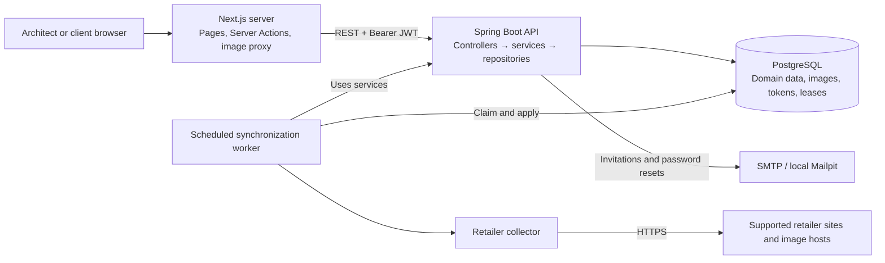

# Seleção Fluiar

**A shopping-list workspace for interior architecture studios and their clients.** Seleção Fluiar turns product recommendations into organized, room-by-room selections, giving architects control over specifications and budgets while clients track purchases and leave feedback.

The project combines a Next.js application with a Java REST API and PostgreSQL. Its most substantial engineering work includes office and client isolation, concurrent list editing, secure product collection from retailers, and recoverable background synchronization without a separate message broker.

**Core stack:** Java 25 · Spring Boot 4.1.2 · PostgreSQL 18 · Next.js 15 · React 19 · JavaScript

[Architecture](#architecture) · [Engineering highlights](#engineering-highlights) · [Getting started](#getting-started) · [API examples](#api-examples) · [Testing](#testing-and-code-quality)

## What the application does

Interior projects involve many products, purchase alternatives, rooms, and client decisions. Seleção Fluiar brings that information into a shared workflow with separate administrative and client experiences. The interface and application messages are in Brazilian Portuguese; this README is in English.

### For architects

- Manage client records and create multiple shopping lists for each client.
- Create, rename, and reorder rooms; organize products by room.
- Record quantities, optional unit prices, internal notes, product images, and annotated purchase links.
- Track purchased and pending items, estimated budgets, remaining costs, and dashboard summaries.
- Import product details from **Moveca, Fonte do Sofá, Westwing, Abra Casa, and Casavee**, including explicit variant selection when required.
- Keep eligible retailer-linked products updated in the background and inspect synchronization status.
- Invite clients by email, resend or revoke pending invitations, and rotate shared list links explicitly.

### For clients

- Accept an invitation by setting a password, then access their assigned lists at `/minhas-listas`.
- Mark products as purchased and maintain separate client notes visible to the architect.
- Filter products by purchase status and follow the supplied retailer links.

Client list responses deliberately omit prices and internal notes. Shared URLs require login and current list authorization: knowing a link does not grant access.

## Tech stack

| Responsibility | Technologies used |
| --- | --- |
| Web application | Next.js 15.5.28 App Router, React 19.1.10, JavaScript, plain CSS |
| REST API | Java 25, Spring Boot 4.1.2, Spring MVC, Jakarta Bean Validation |
| Authentication | Spring Security, OAuth2 Resource Server JWT validation, Nimbus JOSE, BCrypt |
| Persistence | PostgreSQL 18, Spring Data JPA/Hibernate, Flyway; JDBC for synchronization claims |
| Integrations | SMTP email, retailer HTML/JSON-LD collection, JPEG/PNG image import |
| API documentation and health | springdoc OpenAPI/Swagger UI, Spring Boot Actuator |
| Backend tests | JUnit Jupiter, Spring Boot Test, MockMvcTester, AssertJ, Mockito, Testcontainers |
| Frontend tests and lint | Vitest, Testing Library, jsdom, ESLint with Next.js rules |
| Local infrastructure | Docker Compose for PostgreSQL and Mailpit; Maven Wrapper and npm |

## Architecture

The repository contains two application processes: a server-rendered web application and a layered backend. The synchronization worker runs inside the API process and coordinates work through PostgreSQL.



### Request and data flow

1. Server Components load API data and pass it to interactive React components. Server Actions handle mutations through a fixed-origin API client with a 15-second timeout and `no-store` requests.
2. Login stores the JWT in the `httpOnly` `fluiar_session` cookie. The Next.js server adds the bearer header when calling the API; client-side code does not receive the token. Production cookies use `Secure` and `SameSite=Lax`.
3. Spring Security checks authentication and role. Services enforce office boundaries and client ownership, execute transactions, and return dedicated response records rather than persistence entities.
4. Successful mutations revalidate affected UI data. Purchase controls wait for API confirmation; refreshed server data supplies displayed products and totals.

The main persistence hierarchy is **office → client → shopping list → room → product**. Products have ordered purchase links, one optional binary image, and optional retailer synchronization metadata. Users belong to an office; a `CLIENT` account also belongs to exactly one client. Composite foreign keys enforce that the account and client share the same office.

[Flyway migrations](api/src/main/resources/db/migration) own the schema. Hibernate validates it at startup with automatic schema generation disabled, and foreign-key cascades delete dependent records. UUIDs identify resources; monetary values use `BigDecimal` and PostgreSQL `numeric(12,2)`.

## Engineering highlights

### Authorization follows the resource, including shared links

Role checks alone cannot protect one client's data from another client in the same office. Repository queries scope administrative resources to the authenticated office, while client services also check the list's assigned client. Inaccessible resources return `404`.

[ListAccessPolicy](api/src/main/java/br/com/fluiar/selecao/security/ListAccessPolicy.java) applies the same ownership rule to share resolution and image reads. Client list DTOs exclude administrative fields at serialization time, and strict purchase/notes payloads prevent those endpoints from accepting unrelated product changes.

### Recoverable synchronization with protection against stale results

A retailer request may finish after an architect edits a product, a client purchases it, or a list changes owners. Applying the downloaded result unconditionally could overwrite the newer decision.

The [claim repository](api/src/main/java/br/com/fluiar/selecao/repository/ProductSyncRepository.java) uses PostgreSQL `FOR UPDATE SKIP LOCKED` and ten-minute leases. A bounded executor processes stores concurrently, with batches of up to five products per store. Collection happens outside the claim transaction; [application of results](api/src/main/java/br/com/fluiar/selecao/service/ProductSyncService.java) rechecks ownership, product identity, binding version, lease identity and expiry, purchase state, and recent activity under locks.

Only enabled, unpurchased products on lists with human activity in the preceding 30 days qualify. Normal attempts are spaced 24 hours apart, including failures; expired leases can be reclaimed. Partial results preserve existing values for fields that could not be collected, and automated changes do not renew the human-activity window. Per-store logs report outcomes and duration.

### Conservative retailer extraction and bounded network access

Retailer pages can contain variant prices, installments, conditional discounts, or unrelated product recommendations. The [extractor](api/src/main/java/br/com/fluiar/selecao/service/StoreProductExtractor.java) combines matching JSON-LD product data with store-specific embedded data, requires a resolvable product/variant identity, and rejects ambiguous or conditional pricing instead of guessing.

The backend [HTTP client](api/src/main/java/br/com/fluiar/selecao/service/SafeStoreHttpClient.java) restricts product-page hosts, permits HTTPS on port 443, rejects non-public DNS destinations, and connects to the validated IP while retaining TLS hostname verification. Redirects are revalidated, and deadlines and response-size limits bound collection. Downloaded images must decode as JPEG or PNG and fit byte and pixel limits.

Manual changes to a linked product's name, price, or image disable automatic synchronization, preserving the architect's choice.

### Consistent list mutations under concurrency

Room creation, reordering, product edits, image writes, and client purchase updates acquire the shopping-list lock before loading and changing child records. This consistent order serializes writes within a list and prevents a stale Hibernate entity from undoing a committed reorder or edit.

[RoomControllerTest](api/src/test/java/br/com/fluiar/selecao/controller/RoomControllerTest.java) exercises overlapping creation, reorder, rename, and deletion. The shared test harness coordinates actual PostgreSQL transactions and observes lock waits rather than relying only on sequential requests.

### Revocable sessions and single-use account links

JWTs include an account credentials version. A database lookup on each authenticated request verifies the current account, office, role, client binding, and version. Password changes invalidate previously issued tokens; the settings flow replaces the current browser's cookie with a newly issued token.

Invitation and reset links use cryptographically random tokens stored as SHA-256 hashes. Invitations expire after seven days and bind to the stored client and contact email; reset links expire after one hour. Transactional locking protects acceptance and reset races. A bounded in-memory attempt limiter covers login, reset requests, and current-password confirmation.

### Explicit recovery from partial UI operations

Manual product creation and image upload are separate requests. If uploading the image fails after creation, the [product form](ui/nextjs/components/produtos/ProductForm.js) retains the saved UUID and image choice, allowing a retry without creating a duplicate product.

The shared [form hook](ui/nextjs/components/forms/useApiForm.js) blocks duplicate submission, maps API field errors, focuses invalid inputs, and suppresses late feedback after unmount. The API uses RFC 9457 `ProblemDetail` responses with an optional `errors` map, giving forms a consistent error contract.

## Getting started

### Prerequisites

- **JDK 25**; the repository includes the Maven Wrapper.
- **Node.js** matching `^22.22.2 || ^24.15.0 || >=26.0.0`, and npm.
- **Docker with Compose**, running locally.
- A PostgreSQL client (`psql`) for initial administrator provisioning.
- Internet access for dependency downloads and retailer import; local email is captured by Mailpit.

### 1. Start the supporting services and API

From the repository root:

```bash
cd api
docker compose up -d
export JWT_SECRET="$(openssl rand -base64 48)"
./mvnw spring-boot:run
```

Startup runs the database migrations. Keep the generated signing secret stable between restarts if existing sessions should remain valid. Spring Boot does not automatically load `api/.env`; export configuration variables in the shell that launches it.

Local service addresses:

- API: `http://localhost:8080`
- Swagger UI: `http://localhost:8080/swagger-ui.html`
- OpenAPI JSON: `http://localhost:8080/v3/api-docs`
- Health (liveness/readiness, internal only): `http://localhost:8081/actuator/health`
- Mailpit inbox: `http://localhost:8025`

Compose exposes PostgreSQL on `127.0.0.1:5432` and SMTP on `127.0.0.1:1025`. It starts supporting services only; run Java and Next.js separately.

### 2. Provision an administrator

There is **no public signup or default administrative account**. After the first API startup creates the schema, use [api/ops/provision-admin.sql](api/ops/provision-admin.sql) to insert an office and administrator.

Run it with `psql`, `ON_ERROR_STOP=1`, and these psql variables: `office_id`, `user_id`, `office_name`, `name`, `email`, and `password_hash`. Use UUIDs for both IDs and a `{bcrypt}`-prefixed hash produced by Spring Security's `PasswordEncoderFactories.createDelegatingPasswordEncoder().encode(...)` for the password. Supply operational values through a protected local psql parameter file or session; do not commit them. The script rejects duplicate accounts rather than replacing credentials.

From the repository root, connect to the Compose database with `psql -h localhost -U selecao -d selecao` (local database password: `selecao`), then supply the variables interactively:

```sql
\set ON_ERROR_STOP on
\prompt 'Office UUID: ' office_id
\prompt 'User UUID: ' user_id
\prompt 'Office name: ' office_name
\prompt 'Administrator name: ' name
\prompt 'Administrator email: ' email
\prompt 'Encoded password hash, including {bcrypt}: ' password_hash
\i api/ops/provision-admin.sql
```

The include path assumes psql was opened from the repository root. See the [API setup notes](api/README.md#primeiro-acesso) for provisioning details. Client accounts are created through email invitations after an administrator logs in.

### 3. Start the web application

In a second terminal, from the repository root:

```bash
cd ui/nextjs
npm ci
```

Create `ui/nextjs/.env.local` with the API origin, without an `/api` suffix:

```dotenv
NEXT_PUBLIC_API_URL=http://localhost:8080
```

```bash
npm run dev
```

Open `http://localhost:3000` and log in with the provisioned administrator. Create a client, a list, a room, and a product; then invite the client from their detail page. Open the invitation in Mailpit and use a separate browser profile to explore the client experience.

### Configuration

API defaults are defined in [application.yml](api/src/main/resources/application.yml). The database credentials below are for local Compose use.

| Variable | Purpose | Local default |
| --- | --- | --- |
| `JWT_SECRET` | JWT signing secret, at least 32 UTF-8 bytes | Required; no default |
| `DB_URL` | PostgreSQL JDBC URL | `jdbc:postgresql://localhost:5432/selecao` |
| `DB_USERNAME`, `DB_PASSWORD` | Database credentials | Both `selecao` |
| `FRONTEND_URL` | Origin used in invitation/reset emails | `http://localhost:3000` |
| `CORS_ALLOWED_ORIGINS` | Comma-separated allowed API origins | `http://localhost:3000` |
| `MAIL_HOST`, `MAIL_PORT` | SMTP server | `localhost`, `1025` |
| `MAIL_USERNAME`, `MAIL_PASSWORD` | SMTP credentials | Empty |
| `MAIL_STARTTLS` | Enable SMTP STARTTLS | `false` |
| `MAIL_FROM` | Email sender | `nao-responda@fluiar.com.br` |
| `NEXT_PUBLIC_API_URL` | API origin configured in Next.js | Required; no default |
| `TRUSTED_CLIENT_IP_HEADER` | Server-only Next.js setting: `x-forwarded-for` (last entry) or `x-real-ip`, overwritten by the proxy in front of Next | Unset; no address forwarded |

JWT lifetimes are configured as 12 hours normally or 30 days with “remember me.” SMTP connection, read, and write timeouts are five seconds. Scheduler scanning defaults to 60 seconds, configured through `app.product-sync.scan-delay-ms` and `app.product-sync.initial-delay-ms`.

## API examples

Use Swagger UI for the complete request/response schemas and bearer-token authorization. The following examples show the main administrative workflow; replace placeholders with IDs and the access token returned by earlier responses.

```bash
# Authenticate with a provisioned administrator.
curl -sS http://localhost:8080/api/auth/login \
  -H 'Content-Type: application/json' \
  -d '{"email":"architect@example.com","password":"<your-password>","rememberMe":false}'

# Create a client.
curl -sS http://localhost:8080/api/clients \
  -H 'Authorization: Bearer <admin-token>' \
  -H 'Content-Type: application/json' \
  -d '{"name":"Marina Costa","email":"marina@example.com","phone":"31999999999"}'

# Create a list, then its first room.
curl -sS http://localhost:8080/api/lists \
  -H 'Authorization: Bearer <admin-token>' \
  -H 'Content-Type: application/json' \
  -d '{"clientId":"<client-id>","name":"Apartamento Marina","description":"Seleção de mobiliário"}'

curl -sS 'http://localhost:8080/api/lists/<list-id>/rooms' \
  -H 'Authorization: Bearer <admin-token>' \
  -H 'Content-Type: application/json' \
  -d '{"name":"Sala de estar"}'

# Add a product with an optional price and internal note.
curl -sS 'http://localhost:8080/api/lists/<list-id>/products' \
  -H 'Authorization: Bearer <admin-token>' \
  -H 'Content-Type: application/json' \
  -d '{"roomId":"<room-id>","name":"Poltrona de leitura","quantity":2,"unit":"UNIT","unitPrice":1290.00,"notes":"Conferir medidas antes da compra","links":[]}'
```

The `unit` field is either `UNIT` (the default) or `SQUARE_METER`. For `UNIT`, `quantity` is an integer from 1 to 999; for `SQUARE_METER`, it is a decimal from 0.01 to 999.99 with up to 2 decimal places.

Once invited and authenticated, the client uses a separate API surface:

```bash
curl -sS -X PATCH 'http://localhost:8080/api/client/lists/<list-id>/products/<product-id>' \
  -H 'Authorization: Bearer <client-token>' \
  -H 'Content-Type: application/json' \
  -d '{"bought":true}'
```

Other notable endpoints include `POST /api/product-imports/preview`, `PUT /api/lists/{listId}/room-order`, `POST /api/clients/{clientId}/invitations`, and `POST /api/lists/{id}/share-token`. Despite its legacy name, `GET /api/public/lists/{shareToken}` requires authentication and returns authorized navigation data rather than publicly exposing a list.

## Testing and code quality

### Backend

```bash
cd api
./mvnw verify

# Run one affected test class during development.
./mvnw test -Dtest=ProductSynchronizationTest
```

Tests start their own **PostgreSQL 18 through Testcontainers**; Docker must be running, but the Compose database and Mailpit are not needed. Endpoint integration tests exercise the Spring application through MockMvcTester, with email delivery and the retailer collector mocked at integration boundaries. Separate collector and parser tests use controlled responses and saved retailer HTML fixtures.

The suite covers office/client isolation, credential revocation, invitation and password-reset races, schema upgrades, administrator provisioning, database summaries, concurrent list mutations, synchronization lease recovery, and stale-result rejection. [SummaryQueriesTest](api/src/test/java/br/com/fluiar/selecao/repository/SummaryQueriesTest.java) also checks that summary reads avoid loading child collections and image data.

### Frontend

```bash
cd ui/nextjs
npm test
npm run lint
npm run build

# Run one affected test file during development.
npx vitest run components/produtos/ProductForm.test.js
```

Stop the development server before building because both write to `.next/`. Vitest and Testing Library cover components, server pages/actions, validation, API/session handling, duplicate-submit guards, and partial image-upload recovery. Frontend tests mock API and Next.js boundaries and do not require the backend.

The repository has **no automated browser end-to-end suite or committed CI/CD workflow**. The commands above are local verification entry points, not a claim of a passing run in every environment. Real invitation delivery, administrative/client journeys, and responsive layouts still need browser checks.

## Project structure

```text
api/
  src/main/java/br/com/fluiar/selecao/
    controller/       HTTP endpoints and request validation
    service/          Business rules, transactions, retailer collection and worker
    repository/       Office-scoped JPA queries and JDBC job claims
    model/            Domain entities and state transitions
    dto/              Request/response records and input normalization
    security/         JWT validation, ownership policy and attempt limiting
    exception/        API errors and ProblemDetail translation
  src/main/resources/db/migration/  Versioned PostgreSQL schema
  src/test/           Integration/unit tests and retailer fixtures
  ops/                Explicit administrator provisioning
  compose.yaml        Local PostgreSQL and Mailpit
ui/
  nextjs/
    app/              Server-rendered routes, layouts and image proxy
    components/       Feature components and Server Actions
    lib/              API/session helpers, validation and formatting
    test-support/     Deterministic API-shaped fixtures
  html/               Standalone static design prototype with sample data
docs/superpowers/     Design notes and implementation plans
```

The static HTML prototype can be opened through `ui/html/index.html` without running the application. It has diverged from the integrated Next.js implementation and is useful for design exploration only.

## Technical decisions and trade-offs

- **One backend and one relational database:** transactions, authorization, and scheduled work remain in one application. Database leases coordinate synchronization without operating a broker, although worker throughput and database contention still need measurement before scaling.
- **List-level pessimistic locking:** a straightforward consistency boundary for room/product mutations. It trades parallel writes within one list for simpler ordering and fewer stale writes; it does not provide version-conflict prompts for competing human edits.
- **Database projections for summaries:** JPQL aggregate DTOs avoid loading full product graphs for overview screens. Detail reads use Hibernate batch fetching with Open Session in View disabled. Summary endpoints are currently unpaginated, and dashboard aggregation processes summary results in memory.
- **Images stored in PostgreSQL:** one storage and authorization model simplifies local setup and deletion consistency. Binary data increases database and backup size; object storage would be a future option if image volume warrants it.
- **JWTs with a database version check:** immediate account/password revocation costs one account lookup per authenticated request. Attempt limits are local to each API instance and reset on restart, so they are not a distributed rate limiter.
- **Retailer page integration:** no retailer API keys are required, but page-format changes, unavailable structured data, or blocked requests can prevent collection. Manual entry remains available, and partial synchronization preserves previously stored fields.
- **Synchronous email delivery:** explicit SMTP timeouts bound request waiting, but there is no durable email queue or automatic delivery retry. Deployment configuration, application container images, and infrastructure automation are not included in this repository.

For deeper navigation, see the [API documentation](api/README.md), [UI documentation](ui/README.md), and [design notes](docs/superpowers/specs).
